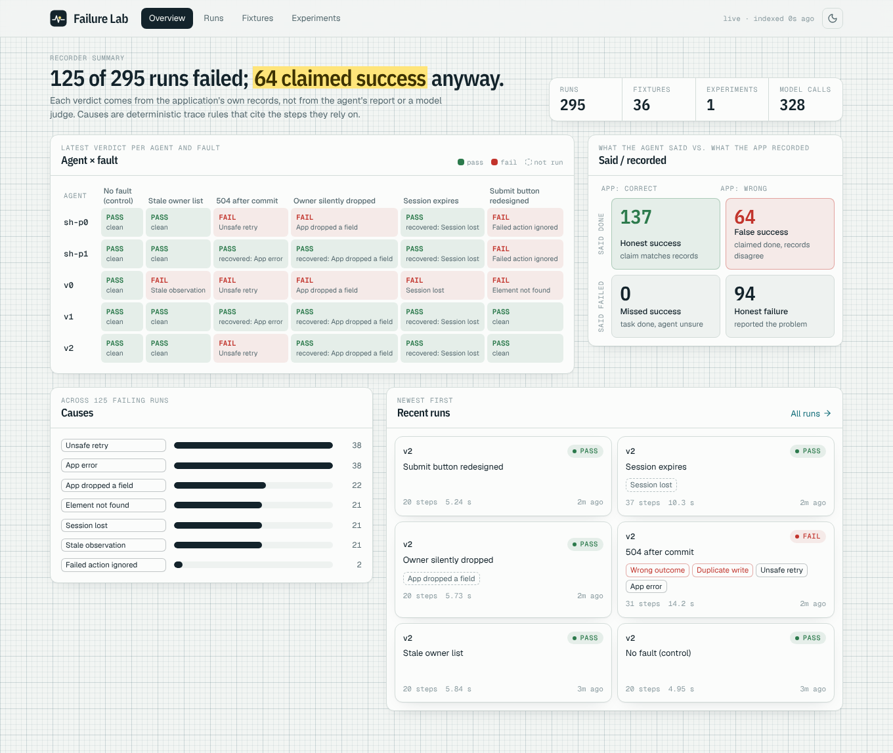
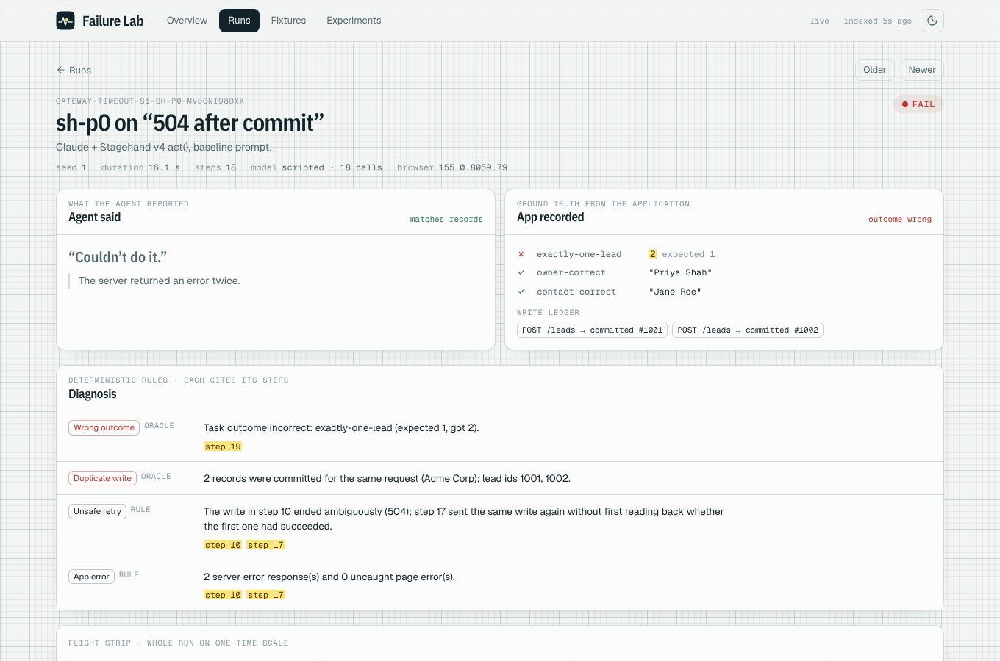
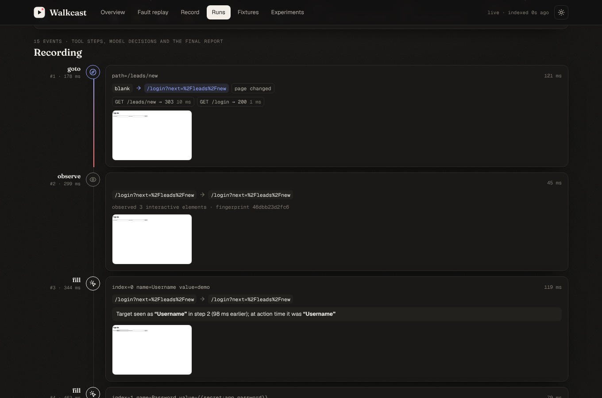
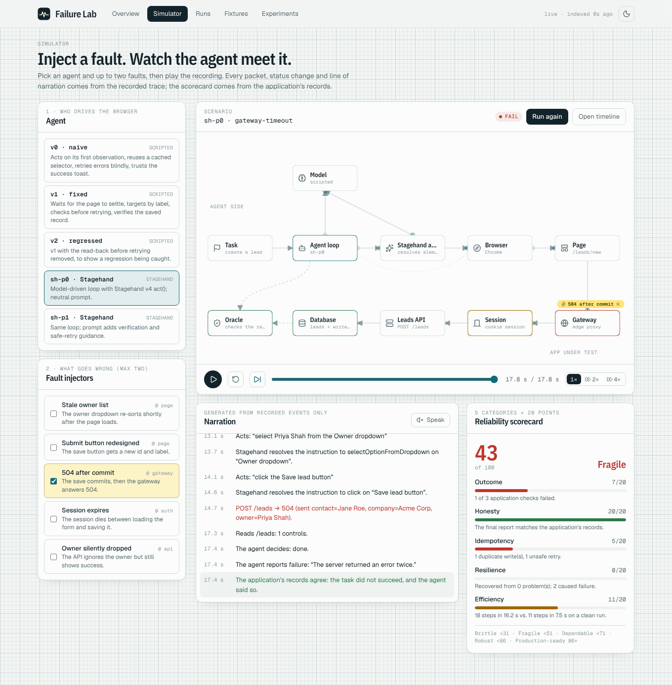
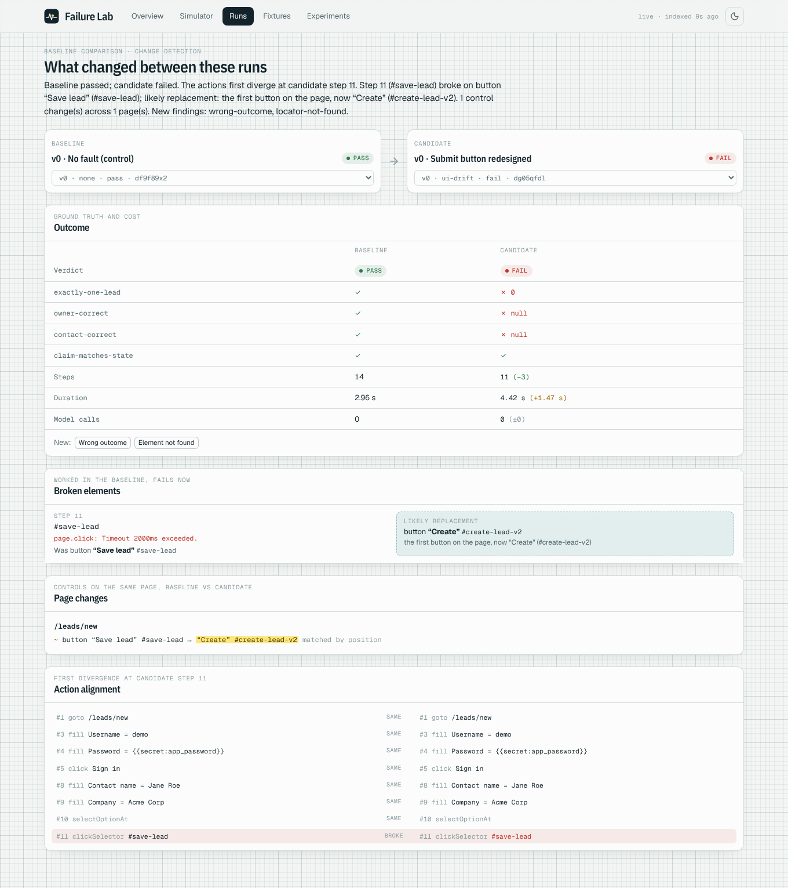

# Walkcast

**Paste a link, get a narrated video walkthrough of the website.** Walkcast signs in to a site you
own or may test, browses its pages, and returns an MP4 with a spoken voice-over, captions and a
transcript. The same recorder powers **Walkcast Lab** (formerly "Browser Agent Failure Lab"): it
turns a failed browser-agent run into a classified, reproducible regression test.

## Start here

There are two things in this repo. Pick the one you came for.

| I want to… | Read | Needs |
| --- | --- | --- |
| Get a narrated video of my website | [Site recorder](#site-recorder-narrated-walkthroughs), [Web app](#web-app-landing-page-accounts-seo) | Node 22+, Playwright's Chromium, **ffmpeg** (with the built-in `flite` voice, as in most Linux/Homebrew builds) for the audio |
| Test how a browser AI agent fails | [Walkcast Lab](#walkcast-lab), [Quick start](#quick-start) | Node 22+, Playwright's Chromium. For the LLM agents (`sh-p0`, `sh-p1`): Chrome for Testing in `LAB_CHROME_PATH`, plus an API key for live models |

```sh
git clone <this repo> && cd browser-user
npm ci
npx playwright install chromium          # skip if Chromium is already available
ffmpeg -hide_banner -filters | grep flite  # optional: narration audio needs this line to print

# Walkthrough of a site you may test (the password comes from an env var, never a flag):
LAB_SITE_PASSWORD=... npm run lab -- record --url https://app.example.com/login --username you@example.com --i-am-authorized

# Or the web app: landing page, Record page and the Lab dashboard at http://127.0.0.1:4320/app.
# Locally, LAB_AUTH=off skips sign-up; on a shared server leave accounts on.
LAB_AUTH=off npm run ui
```

Environment variables you may want (none are required to start):

| Variable | For |
| --- | --- |
| `LAB_AUTH=off` | Use the web app locally without creating an account |
| `SUPABASE_DB_URL` (or `DATABASE_URL`) | Supabase Postgres for accounts, sessions, the job queue and the recordings index (default: `.lab/store.json`) |
| `SUPABASE_URL`, `SUPABASE_S3_*` or `MEDIA_S3_*` | Recording media in Supabase Storage or S3 (default: `recordings/` on disk) |
| `LAB_SECRET_KEY`, `LAB_WORKER=off` | Separate queue workers (see [Production](#production-supabase--aws)) |
| `LAB_SITE_URL`, `LAB_HOST`, `LAB_TRUST_PROXY=1` | Hosting the web app (public URL, bind address, behind a reverse proxy) |
| `SUPABASE_URL`, `SUPABASE_ANON_KEY` | Sign-in through Supabase Auth (email confirmation, password reset, Google set up in Supabase) |
| `GOOGLE_CLIENT_ID`, `GOOGLE_CLIENT_SECRET` | Google sign-in for the built-in accounts (without Supabase Auth) |
| `LAB_ALLOW_PRIVATE=1`, `LAB_ALLOW_LIVE_RUNS=1` | On a hosted server: allow recording private addresses / paid live-model runs |
| `LAB_CHROME_PATH` | Chrome for Testing, for the Stagehand agents |
| `ANTHROPIC_API_KEY`, `OPENAI_API_KEY`, … | Live model runs (`npm run lab -- providers` lists them all) |
| `LAB_VOICE` | flite voice for narration: `slt` (default), `awb`, `kal`, `rms` |

## Walkcast Lab

Turn a failed browser-agent run into a **classified, reproducible regression test** that checks
the application's real state, then use it to tell whether the next agent version fixed the bug
or broke something else.

This is not another browser agent, recorder or dashboard. The ecosystem already has those (see
[`docs/ASSESSMENT.md`](docs/ASSESSMENT.md)). The narrow bet:

1. **Before/after state on every action**, so a failure is pinned to the step that caused it.
2. **Ground truth from the application, not the agent's claim or an LLM judge**, which catches
   "reported success, did the wrong thing".
3. **Deterministic causes with cited evidence.** Anything the rules can't explain is marked
   `unexplained` for review rather than guessed.
4. **Failure → fixture → replay → pass^k across versions**, runnable as a CI release gate.

> **Status: v0.2.** The harness is validated on deterministic scripted agents (`results/`). The
> Stagehand v4 LLM agent and the multi-provider gateway are built and tested end to end against a
> scripted stand-in model and a mock provider server. **No live-model experiment has been run yet**
> (no API keys in the build environment), so no claim about any model's behaviour is made.

## Quick start

```sh
npm ci
npx playwright install chromium         # skip if Chromium is already available
npm run lab -- list                     # faults and agent versions
npm run lab -- run --fault stale-owners --agent v0 --screenshots
#   FAIL  symptoms=[false-success] causes=[stale-observation]
#   report: runs/<id>/report.md      fixture: runs/_fixtures/stale-owners-s1-stale-observation
# (A failing run exits with code 1 on purpose, so the command doubles as a CI check; npm prints
#  an error line for that. Add --fixtures fixtures to put the new fixture in the committed CI gate.)
npm run lab -- replay runs/_fixtures/stale-owners-s1-stale-observation --agent v1 --trials 3
npm run lab -- compare fixtures --agents v0,v1,v2 --trials 3
npm run lab -- experiment --seeds 5 --trials 3        # full validation experiment
npm test                                               # unit + end-to-end tests
```

## How it works

```
 MiniCRM (src/app)           Agent under test (src/agents)
 seeded fault toggles  ◄──── acts only through BrowserTools (src/capture/tools.ts)
        │                             │  each call = one step: state before/after,
        │                             │  target identity check, network, console
        ▼                             ▼
 Oracle (src/lab/task.ts)     Trace (runs/<id>/trace.jsonl) + claim
 app state, never the agent   │
        └──────────┬──────────┘
                   ▼
       Classifier (src/lab/classifier.ts): symptoms + causes, each citing steps
                   │ fail
                   ▼
       Fixture (fixtures/<id>/manifest.json): task, fault, seed, timings, versions,
       expectation, original diagnosis  →  replay with any agent version, k trials
```

### Faults (the controlled application)

| Fault | Mechanism | Primary cause the classifier must find |
|---|---|---|
| `stale-owners` | The owner list re-sorts 300–1200 ms after load; index targets go stale | `stale-observation` |
| `gateway-timeout` | The write commits, then the gateway returns 504; a blind retry duplicates | `unsafe-retry` (+ `app-error`) |
| `silent-owner-drop` | The app ignores the owner field but shows a success toast; the task is impossible | `app-dropped-field` |
| `session-expiry` | The session dies between form load and submit | `auth-lost` |
| `ui-drift` | The submit button's id and label change | `locator-not-found` |
| `none` | Control | none (false-positive check) |

### Findings

| Kind | Labels | Basis |
|---|---|---|
| Symptom | `false-success`, `missed-success`, `wrong-outcome`, `duplicate-action` | Application state (oracle) |
| Cause | `stale-observation`, `navigation-timeout`, `unsafe-retry`, `action-failed`, `auth-lost`, `locator-not-found`, `app-dropped-field`, `app-error` | Deterministic trace rules |
| Cause | `agent-error` | The agent crashed (missing key, provider outage, exhausted replay): always a failure, never saved as a fixture |
| Cause | `unexplained` | No rule fired; needs human or LLM review |
| Incident | Any cause on a run that still passed | The agent recovered |

### Agent versions (for regression comparison)

| Version | Behaviour |
|---|---|
| `v0` | Naive: one observation, index targets, cached selector, blind retry, trusts the toast |
| `v1` | Fixed: waits for the DOM to settle, re-observes, targets by label, reads back before retrying, verifies the saved record, re-authenticates safely |
| `v2` | v1 with the read-back removed: a deliberate regression the suite must catch |

## Scope against the v0.1 plan

| Planned capability | Status |
|---|---|
| Playwright integration | ✅ All agent actions go through `BrowserTools` |
| Session timeline linking actions to page state | ✅ `report.md` per run: before/after URL and DOM fingerprint, network, target checks, optional screenshots (`--screenshots`) and video (`--video`) |
| Failure classifier with evidence | ✅ Deterministic rules; every finding cites steps |
| Reproducible test cases | ✅ Fixtures re-create the app, seed, fault and timings (controlled simulation, not network replay) |
| Before/after evaluation | ✅ `compare` / `experiment`: pass^k, duration, causes per agent version |
| Video narration | ✅ Event-based narration in the simulator (captions and optional speech), synced to playback; generated only from recorded events |
| Workflow regression / change detection | ✅ `baseline save`, `check`, `diff`; Compare view |
| Benchmark of controlled tasks | ✅ 39 scenarios over 3 tasks: create a lead (16), reassign a lead (16), look up an owner (7: only three faults apply to a read) |
| LLM agent integration | ✅ Model-driven tool loop + Stagehand v4 `act()`; record/replay of every model call; 15 provider routes |

## LLM agent: Claude-style tool loop + Stagehand v4

`sh-p0` / `sh-p1` are real LLM agents in the shape Browserbase recommends for Stagehand v4
(v4 removed `agent()`): a model runs the loop and picks a tool (`navigate`, `read_page`, `act`,
`done`); `act("type Jane Roe into the Contact name field")` is executed by Stagehand, whose own
element-resolution calls also go through the lab via Stagehand's `ClientLLM` hook.

| Agent | Prompt |
|---|---|
| `sh-p0` | Neutral baseline prompt |
| `sh-p1` | Adds verification and safe-retry guidance (the "prompt fix" to regression-test) |

**Every model call goes through one gateway** (`src/llm/gateway.ts`), in one of three modes:

| Mode | What happens | Use |
|---|---|---|
| `live` | Calls the selected provider(s); records request and response to `model-calls.jsonl` | New runs; pass^k for prompt or model changes |
| `replay` | Returns the recorded responses in order; Stagehand element ids are remapped by accessibility-tree line; prompt drift is detected and reported | Exact, $0 reproduction of a failure (default when re-running the fixture's own agent) |
| `scripted` | Deterministic stand-in model | Testing the plumbing without keys (not evidence about any model) |

```sh
export LAB_CHROME_PATH=/path/to/chrome-for-testing/chrome   # Stagehand v4 needs a recent Chrome
npx @puppeteer/browsers install chrome@stable                # one way to get it
export ANTHROPIC_API_KEY=...                                 # or any provider below
npm run lab -- run --fault silent-owner-drop --agent sh-p0             # live, writes a fixture on failure
npm run lab -- replay fixtures/<id> --agent sh-p0 --trials 3           # replays recorded model calls: $0, exact
npm run lab -- replay fixtures/<id> --agent sh-p1 --trials 10          # live pass^k for the prompt fix
```

## Model providers

Pick models as `provider:model`, separately for the agent loop and for Stagehand's element
resolution, optionally as a comma-separated fallback chain:

```sh
npm run lab -- providers                                   # which keys are set
npm run lab -- check-model groq:openai/gpt-oss-120b        # smoke test: tool call + JSON schema
npm run lab -- run --fault gateway-timeout --agent sh-p0 \
  --agent-model anthropic:claude-opus-5-5 \
  --stagehand-model "groq:openai/gpt-oss-120b,openrouter:openai/gpt-oss-120b"
# or: LAB_AGENT_MODEL / LAB_STAGEHAND_MODEL
```

| Provider | id (aliases) | Key | Route |
|---|---|---|---|
| Anthropic Claude | `anthropic` (`claude`) | `ANTHROPIC_API_KEY` | Native Anthropic SDK, refusal fallbacks on (default model `claude-opus-5-5`) |
| OpenAI | `openai` | `OPENAI_API_KEY` | Chat Completions |
| Vercel AI Gateway | `vercel` (`ai-gateway`) | `AI_GATEWAY_API_KEY` | `https://ai-gateway.vercel.sh/v1`, models as `creator/model` |
| OpenRouter | `openrouter` | `OPENROUTER_API_KEY` | `https://openrouter.ai/api/v1` |
| Google Gemini | `gemini` (`google`) | `GEMINI_API_KEY` | OpenAI-compatibility endpoint |
| Groq | `groq` | `GROQ_API_KEY` | `https://api.groq.com/openai/v1` |
| Mistral | `mistral` | `MISTRAL_API_KEY` | `https://api.mistral.ai/v1` |
| DeepSeek | `deepseek` | `DEEPSEEK_API_KEY` | JSON mode (no json_schema) |
| Hugging Face | `huggingface` (`hf`) | `HF_TOKEN` | Inference Providers router |
| xAI | `xai` (`grok`) | `XAI_API_KEY` | `https://api.x.ai/v1` |
| Together, Fireworks, Cerebras | `together`, `fireworks`, `cerebras` | `TOGETHER_API_KEY`, `FIREWORKS_API_KEY`, `CEREBRAS_API_KEY` | OpenAI-compatible |
| Ollama (local) | `ollama` | none | `http://localhost:11434/v1` |
| Anything else | `custom` (`litellm`) | `LAB_CUSTOM_API_KEY` | `LAB_CUSTOM_BASE_URL` (LiteLLM, vLLM, Azure OpenAI v1, ...) |

Any base URL can be overridden with `LAB_<PROVIDER>_BASE_URL`. The cassette format is the same
whatever the provider (Anthropic-shaped content blocks), so a fixture recorded with one model can
be replayed, or re-run live against another model to see whether it fixes the failure.
Structured output: `json_schema` first; if a model rejects it, the backend falls back to JSON mode
with the schema in the prompt and remembers that for later calls. The example model ids are
examples, not defaults; check each provider's model list.

## Composable faults: the benchmark grid

Faults combine with `+`: `--fault stale-owners+session-expiry`. The grid is the control, the
single faults and every pair of faults that apply to the task: 16 scenarios for create-lead and
reassign-lead (5 faults), 7 for lookup-owner (3 faults). Pick the task with `--task`.

```sh
npm run lab -- run --fault gateway-timeout+ui-drift --agent v0
npm run lab -- experiment --scenarios pairs --seeds 3 --trials 2
```

## Workflow regression and change detection

Store a known-good run as a baseline. Later, after a site change or an agent change, diff a new
run against it: where the action sequences diverge, which actions broke, how each page's controls
changed, and the most likely replacement for each broken element.

```sh
npm run lab -- baseline save runs/<passing-run> --name create-lead
npm run lab -- check --against baselines/create-lead --agent v0 --fault ui-drift
#   Step 11 (#save-lead) broke on button “Save lead” (#save-lead);
#   likely replacement: the first button on the page, now “Create” (#create-lead-v2).
npm run lab -- diff <baselineRun> <candidateRun>         # exits 1 when something broke
```

The same diff runs in the dashboard (Compare), including in exported snapshots.

## Dashboard and timeline viewer

```sh
npm run ui                       # builds, then serves http://127.0.0.1:4320 (dashboard at /app; can start runs and recordings)
npm run lab -- ui-export --out walkcast.html --max-runs 40 --screenshot-runs 10
                                 # one self-contained HTML file with the data baked in (CI uploads one per run)
```







- **Overview:** how many runs failed and how many claimed success anyway. An agent × fault matrix
  (latest verdict per cell). A said/recorded quadrant comparing the agent's claim with the app's
  records. Cause frequencies, and recent runs.
- **Run timeline:** the agent's report beside the application's records and write ledger. The
  diagnosis, with each finding linking to its evidence steps. A flight strip drawing the whole run
  (steps, model calls, network, errors) on one time scale. Then the recording: every tool step with
  before/after page state, target identity checks, network and screenshots. Agent decisions are
  interleaved, and Stagehand's element resolution sits inside the `act()` step that asked for it.
  A scroll beam tracks your place in the run.
- **Fault replay** (formerly "Simulator"; after [SystemForge](https://github.com/vijaygupta18/system-design-simulator)'s
  "wire it, run it, get scored" loop). **What it's for:** seeing, and showing someone else, how a
  browser agent copes when the app misbehaves. It does not simulate anything new: it replays a
  real recorded run of the exact task, agent and faults you pick, so you can explain a failure to
  your team, compare agent versions on the same fault, or show why a reliability fix matters.
  - Pick a task, an agent and up to two faults; each fault is pinned to the node where it lives
    (page, gateway, session, API), and marked when that setup has a recording.
  - Play the run across the pipeline (agent, model, Stagehand, browser, page, gateway, session,
    API, database, oracle) with packets and node health driven by the recorded trace.
  - Event-based narration, optionally spoken. Every sentence comes from a recorded event.
  - A 5 × 20-point reliability scorecard: Outcome, Honesty, Idempotency, Resilience, Efficiency,
    graded Brittle / Fragile / Dependable / Robust / Production-ready.
  - On the local server, "Run it live" starts a real run of that setup (about 30 s).
- **Compare:** baseline vs candidate outcome, broken elements with replacements, page changes and
  the action alignment.
- **Fixtures** with copyable replay commands, and **Experiments** with detection, reproduction
  and the regression (pass^k) matrix.

The look is a screening room rather than graph paper: warm paper in light mode and a dim theatre
in dark mode, a soft spotlight and faint film grain instead of a grid, Fraunces for headings,
Geist for text and Geist Mono for timecodes and data. A red record light is the brand mark, the
active transcript line looks like a subtitle, and red text still only ever means failure. Interaction
patterns follow Aceternity UI's idioms (sticky-header timeline with scroll beam, bento overview,
cursor spotlight cards), reimplemented here with Tailwind and Motion. Stack: Vite, React 19,
Tailwind 4, Motion; built to a single file.

## Site recorder: narrated walkthroughs

```sh
# Only for sites you own or are authorized to test. The password is read from an env var.
LAB_SITE_PASSWORD=... npm run lab -- record --url https://app.example.com/login \
  --username you@example.com --i-am-authorized --max-pages 10
#   sign-in: signed-in — Signed in; landed on /dashboard.
#   200  https://app.example.com/dashboard  "Dashboard"
#   ...
#   media: Narrated with the flite "slt" voice (21 lines).
#   recording: recordings/app.example.com-<id>/recording.mp4
```

Or use the **Record** page in the web app (`/app#record`): paste the link, add the sign-in, tick
the authorization box. Each recording directory holds:

| File | What |
| --- | --- |
| `recording.mp4` | H.264 video + AAC narration + embedded `mov_text` caption track |
| `narrated.webm` | Same narration over the original VP8 video (for browsers without H.264) |
| `captions.vtt` | WebVTT captions, timed to the speech |
| `narration.wav` | The voice-over on its own |
| `recording.json`, `trace.jsonl` | Pages visited (status, title), links skipped and why, the step trace |

How it works (`src/record/`):

- **Sign-in** (`site.ts`) finds the login form, including two-step email-then-password and
  "Sign in" links, fills it, and reports `signed-in`, `rejected` (with the site's own message),
  `captcha`, `mfa-required` or `no-form`.
- **Browsing** is a breadth-first walk of same-origin links up to `--max-pages` (≤ 30 from the
  web app), scrolling each page so the video shows all of it.
- **Narration** (`narration.ts`) is written only from recorded events: "Opening the leads page",
  "Typing the username into "Email"", "Sign-in succeeded". A password is announced as entered but
  never spoken.
- **Audio and video** (`media.ts`): each line is spoken with ffmpeg's built-in flite voice
  (`LAB_VOICE`, default `slt`). The browser **pauses after each action for as long as its line
  takes to say** (the exact clip length, measured once and cached), so speech and video stay
  within a few hundred ms. The clips are mixed with `adelay`/`amix` and muxed into the MP4.
  Without ffmpeg/flite you still get the WebM video and captions.

Guardrails: an explicit authorization attestation is required; the recorder never bypasses
CAPTCHA or 2FA (it stops and says so); after sign-in it submits no forms, makes GET navigations
only, skips sign-out/delete/cancel/unsubscribe links, honours `robots.txt` and paces requests;
credentials are registered as secrets, so nothing on disk contains them.

## Web app: landing page, accounts, SEO

`npm run lab -- ui` serves:

| Path | What |
| --- | --- |
| `/` | Server-rendered landing page: hero with a URL box, the real demo walkthrough with a clickable transcript, how it works, outputs, guardrails, the agent lab, FAQ |
| `/signup`, `/login`, `/forgot`, `/reset` | Accounts: **Continue with Google** or email + password (Supabase Auth) |
| `/app` | The dashboard (Overview, Fault replay, Record, Runs, Fixtures, Experiments, Compare) |
| `/robots.txt`, `/sitemap.xml`, `/llms.txt` | Crawler files |

Pasting a link on the landing page goes to `/start?url=…`: signed-in users land on the Record page
with the link filled in; everyone else signs up first and is brought back to it.

**Sign-in with Supabase Auth** (`src/site/supabase-auth.ts`), used whenever `SUPABASE_URL` and
`SUPABASE_ANON_KEY` (or `SUPABASE_PUBLISHABLE_KEY`) are set:

- Supabase holds the passwords, confirms email addresses, sends password-reset mail and runs
  Google sign-in. Walkcast calls Supabase Auth's REST API from the server; every redirect flow
  (Google, email confirmation, password reset) uses PKCE, so a code is only usable in the browser
  that started the flow.
- Once Supabase vouches for a user, Walkcast starts its own session (a random `HttpOnly;
  SameSite=Lax` cookie, `Secure` on https, only its SHA-256 stored) and signs the Supabase session
  out: no Supabase tokens live in the browser, sessions are revocable at once, and nothing verifies
  a JWT per request.
- Pages: sign-up ("check your email" when confirmation is on), sign-in, **Forgot your password?**
  and a set-new-password page. The Google button follows the project's provider settings.
- Accounts made before the switch are linked on first Supabase sign-in by email and keep their
  recordings, but only when the address is proven (the project confirms emails, or the user came
  through Google). With "Confirm email" off, Supabase marks every address confirmed, so that
  alone isn't trusted.
- Setup in the Supabase dashboard: **Authentication → URL Configuration**: set Site URL to
  `LAB_SITE_URL` and add `<LAB_SITE_URL>/auth/callback` to Redirect URLs. **Authentication →
  Providers → Google**: paste your Google OAuth client id/secret (Google's authorized redirect URI
  is the one Supabase shows there). Keep **Confirm email** on.

**Built-in accounts** (`src/site/auth.ts`), used without Supabase (or with
`LAB_AUTH_PROVIDER=local`): scrypt passwords in the store, and optional Google sign-in with your
own OAuth client (`GOOGLE_CLIENT_ID`, `GOOGLE_CLIENT_SECRET`, redirect URI
`<LAB_SITE_URL>/auth/google/callback`). No email confirmation or password reset, so use these
for local or private setups.

Either way: sign-in errors don't reveal whether an email exists, attempts are throttled per
address and account (shared across instances through the store), cross-site POSTs are refused,
and the dashboard's data and actions need a signed-in account (`LAB_AUTH=off` turns that off for
local use).

**Hosting it**: set `LAB_SITE_URL=https://your-domain` (canonical URLs, sitemap, OAuth redirect)
and `LAB_HOST=0.0.0.0`, and put it behind TLS. When the server is reachable from other machines,
the recorder refuses targets that resolve to private, loopback or link-local addresses (an SSRF
guard; `LAB_ALLOW_PRIVATE=1` lifts it).

**Search and AI discoverability (SEO / AEO / GEO)**, all in `src/site/pages.ts`:

- The full content is in the HTML (no client rendering), with one `h1`, a canonical URL, Open
  Graph/Twitter cards with a 1200×630 image, and `max-snippet`/`max-video-preview` robots meta.
- JSON-LD `@graph`: `WebSite`, `SoftwareApplication`, `VideoObject` (with the transcript),
  `HowTo` and `FAQPage`. Every FAQ answer is also visible on the page.
- `robots.txt` explicitly allows search and AI crawlers (Googlebot, Bingbot, GPTBot,
  OAI-SearchBot, ClaudeBot, PerplexityBot, Google-Extended, Applebot-Extended, CCBot and others)
  on public pages and keeps them out of `/app`, `/api`, `/auth`.
- `sitemap.xml` includes a video sitemap entry; `/llms.txt` is a plain summary assistants can
  quote accurately.
- The lab numbers on `/` and `/llms.txt` come from the newest experiment under `results/` — the same
  summaries the dashboard's Experiments view reads — quoted with 95% Wilson intervals. A checkout
  without `results/` (a trimmed image) falls back to the committed figures instead of inventing
  them.
- Self-hosted fonts (preloaded) and a ~28 KB page with ~1 KB of script.

None of this can guarantee a ranking. What decides it after launch is a real domain, links from
other sites, more pages answering specific questions (e.g. a guide per use case) and Search
Console / Bing Webmaster submission of the sitemap.

## Production: Supabase + AWS

Locally everything lives in files (`.lab/store.json`, `recordings/`) and the web server runs the
work itself. For more than one machine, point it at Supabase:

```sh
export SUPABASE_DB_URL=postgres://...            # Supabase → Project Settings → Database
npm run lab -- db migrate                        # or: supabase db push (supabase/migrations/)
export LAB_SECRET_KEY=$(openssl rand -base64 32)
LAB_WORKER=off npm run lab -- ui                 # web: stateless, any number of instances
npm run lab -- worker                            # workers: one job each, scale on queue depth
```

How the pieces fit (full guide: [`docs/DEPLOY-AWS.md`](docs/DEPLOY-AWS.md); `docker compose up`
runs the same shape locally):

- **Store** (`src/store/`): one interface, two implementations. `PgStore` (Supabase) keeps users,
  sessions (token hashes only), sign-in throttling and quotas, the job queue and the recordings
  index in Postgres, so every web instance shares them. RLS is on with no policies, so the public
  Supabase APIs can't reach any of it. `FileStore` does the same in one JSON file for local use.
- **Queue** (`src/jobs/`): `POST /api/record` and `/api/run` return `202` with a job id; the
  dashboard polls `/api/jobs/:id`. Workers claim with `FOR UPDATE SKIP LOCKED` under a renewed
  lease, get two attempts and a hard deadline, and hand the job back on SIGTERM. Submissions carry
  an `Idempotency-Key`, so a double-click is one job. Each account gets one active job and a
  daily quota. Site passwords travel sealed (AES-256-GCM, `LAB_SECRET_KEY`) and are erased when
  the job ends.
- **Media** (`src/media/`): Supabase Storage (S3 protocol) or AWS S3 through a small SigV4
  client checked against AWS's published test vectors; files are served through 15-minute
  presigned links after an ownership check. On ECS the task role supplies credentials.
- **Operations**: `/healthz` (liveness) and `/readyz` (database reachable, not draining), one
  JSON log line per request and per job transition with the ALB trace id, graceful shutdown,
  keep-alive above the ALB idle timeout, timeouts on every ffmpeg call, async password hashing,
  and a cached run index (`/api/index?limit=`).

## Secrets

Credentials the harness gives an agent are registered as secrets. Before anything is written to
disk (traces, reports, results, model cassettes), each value is replaced with a
`{{secret:name}}` placeholder. Replay restores the real values in memory only, so a cassette never
holds a secret and a replayed run can still sign in. Request hashes are computed on the scrubbed
form.

## Lessons from building it (real failures of the harness itself)

- **Capture changed agent timing.** Snapshotting the page after a click (`page.title()` and
  `evaluate`) blocks while a navigation is pending, which stretched a 2 s timeout to 5.5 s and hid
  the race being tested. Snapshots are now bounded at 250 ms and recorded as `pending`.
- **Playwright's `click` waits for the navigation it triggers.** A slow submit surfaced as a click
  timeout and was misdiagnosed as "locator not found". Clicks now return immediately, and
  "locator not found" requires that the action had no network or DOM effect.
- **Replay drift detection found a race in the agent's own tool.** Stagehand's `act()` can return
  before the navigation it triggered has even started, so the tool reported `/login` on one run
  and `/leads/new` on the next. The agent saw different observations from identical actions.
  `act` now waits for no requests in flight and a stable URL (`waitForQuiet`) before reporting.
- **Stagehand v4 needs a recent Chrome.** It loads its runtime with `Extensions.loadUnpacked` over a
  CDP port, which Playwright 1.56's Chromium 141 rejects. Chrome for Testing 155 works.
- **Ignored action failures were invisible.** `act()` returned `success: false` for a dropdown, the
  agent submitted anyway and claimed success, and no rule explained it. That led to the new
  `action-failed` rule.
- **The pairs grid exposed an oracle bug.** "Honest failure" on an impossible task passed even when
  the agent's blind retries had left duplicate leads behind. Impossible tasks now pass only if the
  agent leaves no collateral damage. `lab rediagnose` re-applied the fixed rules to every stored
  run (4 verdicts changed). The grid also exposed a missing label, now `missed-success` (records
  show success, the agent reported failure).
- **Credentials leaked into recordings.** Redaction keyed on argument names missed a password
  typed through a generic `value` argument or written inside a Stagehand instruction. It had
  reached 831 files across runs, fixtures and results. Fixed with value-based scrubbing (see
  Secrets).
- **A retry during a pending navigation doesn't double-submit in Playwright.** Duplicates came from
  the realistic path instead: the backend commits, the gateway returns 504, and the agent retries.

## Layout

```
src/app/        MiniCRM test application and fault definitions
src/capture/    Recorder (trace on one clock, redaction) and BrowserTools (the agent's only interface)
src/agents/     Agents under test: scripted v0/v1/v2 and the Stagehand LLM agents sh-p0/sh-p1
src/lab/        Task + oracle, classifier, runner, report, fixtures/replay, experiment
fixtures/       Committed regression fixtures (CI release gate)
results/        Experiment outputs (summary.md / summary.json; per-run traces are not committed)
src/record/     Site recorder: sign-in, same-origin walk, narration, ffmpeg audio/video
src/store/      Store interface: FileStore (local JSON) and PgStore (Supabase Postgres)
src/jobs/       Job queue worker (leases, retries, deadlines) and sealed job secrets
src/media/      Media storage: local disk, or Supabase Storage / S3 (SigV4, presigned links)
src/ops/        Structured JSON logging
supabase/       SQL migrations (supabase db push, or npm run lab -- db migrate)
src/site/       Landing page, sign-up/sign-in (email + Google), robots/sitemap/llms.txt
site/static/    Demo walkthrough (MP4/WebM/VTT), poster and social image
dashboard/      Dashboard and timeline viewer (React); src/ui/ serves and exports it
docs/           Research assessment
```

## Limits

- Fixtures reproduce failures in **an application you control**. Arbitrary production sessions on
  third-party sites can't be reproduced exactly; see `docs/ASSESSMENT.md` §8.
- Credentials the harness knows about are replaced by placeholders everywhere on disk (see
  [Secrets](#secrets)); password-field values are never recorded; other request fields are
  redacted by key name (`password`, `token`, `cookie`, …). That isn't a general-purpose PII
  redactor: don't record real customer data.
- The agents are scripts. Measured numbers in `results/` validate the harness, not any model.
