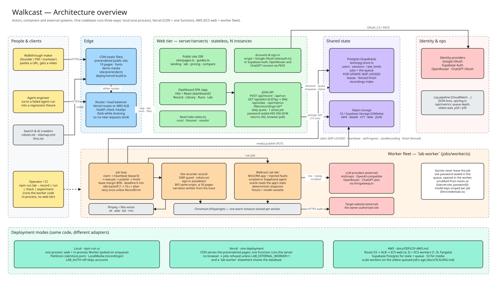
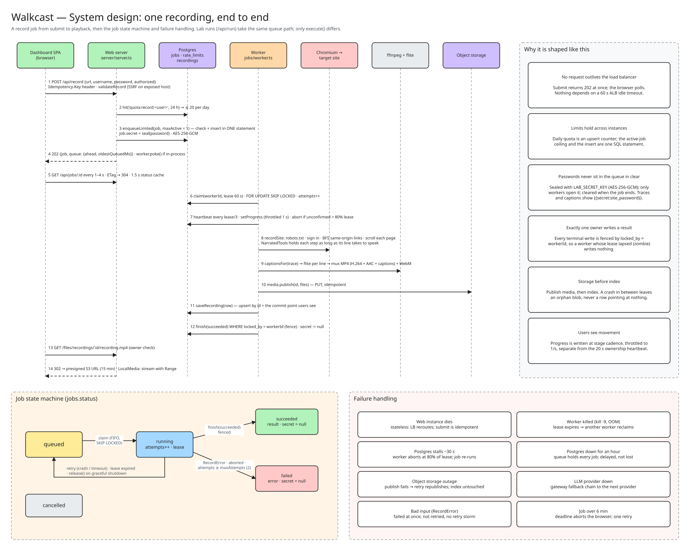
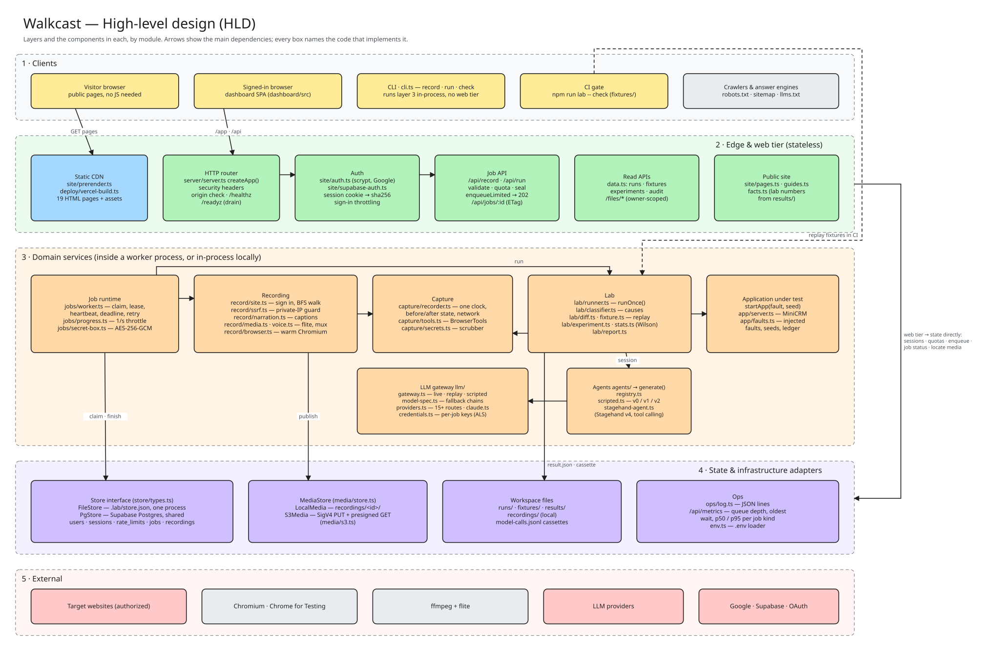
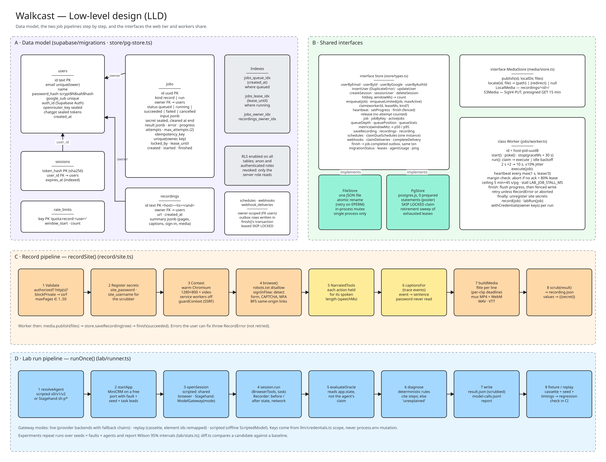

# Walkcast

**Paste a link, get a narrated video walkthrough of the website.** Walkcast drives a real browser
through a site you own or may test and returns an MP4 with a spoken voice-over, captions and a
transcript. The same recorder powers **Walkcast Lab**: it turns a failed browser-agent run into a
classified, reproducible regression test.

MIT licensed. The price is zero.

---

## Architecture

Walkcast is one engine (`packages/core`) shared by two apps: a static marketing site (`apps/web`)
and a desktop app (`apps/desktop`) that bundles a Node server + Tauri shell. In production the
same server runs stateless behind a load balancer with a Postgres store, an S3-compatible media
bucket and a fleet of browser workers.

### 1. Architecture overview



Who uses Walkcast, the containers (edge, web tier, Postgres, object storage, worker fleet) and the
external systems, plus the three deployment modes: **local**, **Vercel** (marketing site) and
**AWS** (full stack).

### 2. System design (one recording, end to end)



A single recording as a sequence: submit → quota check → atomic enqueue → poll → claim →
heartbeat → record → encode → publish → index → fenced finish → presigned playback. Includes the
job state machine and how each failure is handled. See [`docs/SYSTEM-DESIGN.md`](docs/SYSTEM-DESIGN.md)
for the correctness guarantees (fenced finalization, atomic tenant limits, at-least-once execution
with idempotent effects) and the failure-domain table.

### 3. High-level design



Five layers: clients → edge & web → domain services → state adapters → external systems. Each box
names the module that implements it.

### 4. Low-level design



The Postgres schema and indexes, the `Store` / `MediaStore` interfaces and the `Worker` class, and
the `recordSite()` and `runOnce()` pipelines step by step.

The diagrams are editable Excalidraw files in [`docs/architecture/`](docs/architecture/) (open at
[excalidraw.com](https://excalidraw.com)). Regenerate with `python docs/architecture/build.py`.

---

## Tech stack

| Layer | Technologies |
| --- | --- |
| Runtime | Node.js ≥ 22, TypeScript 5.9, tsx |
| Browser automation | Playwright 1.56 (Chromium), `@browserbasehq/stagehand` 4.2 (v4, Chrome for Testing) |
| Media | ffmpeg (flite voices `slt`/`awb`/`kal`/`rms`, or Windows SAPI), H.264 MP4 + AAC, WebM (VP8) |
| LLM gateway | Anthropic SDK, OpenAI SDK, 15 provider routes (Anthropic, OpenAI, Vercel AI Gateway, OpenRouter, Gemini, Groq, Mistral, DeepSeek, Hugging Face, xAI, Together, Fireworks, Cerebras, Ollama, custom/LiteLLM) |
| Web UI | React 19, Vite 8, Tailwind CSS 4, Motion 14, lucide-react, `@vercel/analytics` (opt-in) |
| Desktop shell | Tauri 2, Rust sidecar, Node binary staged per OS |
| State | Postgres (Supabase) via `postgres` 3.4, or local JSON `FileStore` |
| Object storage | Supabase Storage (S3 protocol, bucket `recordings`) — or AWS S3 via `MEDIA_S3_*` — or local disk (`recordings/`) |
| Object storage | Supabase Storage (S3 protocol) or AWS S3 via a small SigV4 client, presigned links |
| Queue | Postgres `FOR UPDATE SKIP LOCKED` leases, attempts, deadlines, idempotency keys |
| Deploy | Vercel (marketing site), Docker / ECS (full stack), GitHub Actions (release) |
| Quality | ESLint + Prettier, Husky pre-commit, `npm test` (node:test), `tsc --noEmit` |

---

## Quick start

```sh
git clone https://github.com/KunjShah95/browser-user.git && cd browser-user
npm ci
npx playwright install chromium          # skip if Chromium is already available
ffmpeg -hide_banner -filters | grep flite  # optional: narration audio needs this line to print

# Walkthrough of a site you may test (password comes from an env var, never a flag):
LAB_SITE_PASSWORD=... npm run lab -- record --url https://app.example.com/login --username you@example.com --i-am-authorized

# Or the dashboard (Record page and the Lab) at http://127.0.0.1:4320/app
npm run ui
```

Environment variables (none required to start): see [`.env.example`](.env.example) and the
[Production](#production-supabase--aws) section. Common ones: `LAB_AUTH`, `SUPABASE_DB_URL`,
`SUPABASE_URL`, `LAB_SECRET_KEY`, `LAB_WORKER`, `LAB_SITE_URL`, `LAB_HOST`,
`LAB_TTS_PROVIDER`, `LAB_VOICE`, provider API keys (`ANTHROPIC_API_KEY`, `OPENAI_API_KEY`, …).

### Walkcast Lab (browser-agent regression testing)

```sh
npm ci
npx playwright install chromium
node --import tsx apps/desktop/cli.ts list                     # faults and agent versions
node --import tsx apps/desktop/cli.ts run --fault stale-owners --agent v0 --screenshots
node --import tsx apps/desktop/cli.ts replay runs/_fixtures/stale-owners-s1-stale-observation --agent v1 --trials 3
node --import tsx apps/desktop/cli.ts compare fixtures --agents v0,v1,v2 --trials 3
node --import tsx apps/desktop/cli.ts experiment --seeds 5 --trials 3
npm test
```

---

## What it does

### Site recorder (narrated walkthroughs)

```sh
LAB_SITE_PASSWORD=... npm run lab -- record --url https://app.example.com/login \
  --username you@example.com --i-am-authorized --max-pages 10
```

Each recording directory holds `recording.mp4`, `narrated.webm`, `captions.vtt`, `narration.wav`,
`recording.json`, `trace.jsonl`.

How it works (`packages/core/src/record/`):

- **Sign-in** (`site.ts`) finds the login form (two-step email-then-password and "Sign in"
  links included), fills it, reports `signed-in` / `rejected` / `captcha` / `mfa-required` /
  `no-form`.
- **Browsing** is a breadth-first walk of same-origin links up to `--max-pages` (≤ 30 from the
  web app), scrolling each page.
- **Narration** (`narration.ts`) is written only from recorded events; passwords are announced as
  entered but never spoken.
- **Audio/video** (`media.ts`): each line spoken by a TTS engine — ffmpeg's built-in flite voice
  (`LAB_VOICE`, default `slt`), Windows SAPI on Windows, or cloud providers (Sarvam, Bhashini,
  ElevenLabs, Google Cloud, Azure, AWS Polly, OpenAI, Murf, Reverie, custom/Maya) selected via
  `LAB_TTS_PROVIDER` or per recording in Settings/Record. The browser pauses after each action for
  exactly as long as its line takes. Without ffmpeg/flite (and no cloud key) you still get the WebM
  video and captions.

Guardrails: explicit authorization attestation required; never bypasses CAPTCHA/2FA (stops and
says so); after sign-in only GET navigations; skips sign-out/delete/cancel/unsubscribe links;
honours `robots.txt`; paces requests; credentials registered as secrets (never on disk).

### Walkcast Lab (browser-agent regression testing)

Turns a failed browser-agent run into a classified, reproducible regression test that checks the
application's real state, then tells whether the next agent version fixed the bug or broke
something else.

Core ideas:

1. **Before/after state on every action** — failure pinned to the step that caused it.
2. **Ground truth from the application**, not the agent's claim or an LLM judge.
3. **Deterministic causes with cited evidence**; anything unexplained is marked `unexplained`.
4. **Failure → fixture → replay → pass^k across versions**, runnable as a CI release gate.

Faults: `stale-owners`, `gateway-timeout`, `silent-owner-drop`, `session-expiry`, `ui-drift`,
`none`. Faults combine with `+`. Symptoms: `false-success`, `missed-success`, `wrong-outcome`,
`duplicate-action`. Causes: `stale-observation`, `navigation-timeout`, `unsafe-retry`,
`action-failed`, `auth-lost`, `locator-not-found`, `app-dropped-field`, `app-error`,
`agent-error`, `unexplained`.

Agent versions: `v0` (naive), `v1` (fixed), `v2` (v1 with read-back removed — deliberate
regression). LLM agents: `sh-p0` (neutral baseline prompt) and `sh-p1` (adds verification and
safe-retry guidance).

Model gateway (`packages/core/src/llm/gateway.ts`) runs in three modes: `live`, `replay`,
`scripted`. Models picked as `provider:model`, separately for the agent loop and Stagehand element
resolution, optionally as a comma-separated fallback chain.

Workflow regression: `baseline save`, `check`, `diff`. Dashboard: Overview, Fault replay, Record,
Runs, Fixtures, Experiments, Compare.

---

## Two apps, one engine

| | What | Where | Runs on |
| --- | --- | --- | --- |
| **Website** | React landing page (Vite), prerendered at build time. No accounts, no API, no server. | `apps/web/` | Any static host (Vercel) |
| **Desktop app** | The product: recorder, dashboard, lab runs, sign-in, API. Tauri shell around the local Node server. | `apps/desktop/` | Windows, macOS, Linux |

```sh
npm run desktop:dev      # Tauri window over the local server (needs Rust)
npm run desktop:build    # installers for this OS
npm run ui               # the same server in a browser tab, no Tauri
npm run dev              # landing page with hot reload (http://localhost:4330)
npm run web:build        # dist/web
```

The installed app runs its own server; Chromium (~250 MB) downloads once on first launch into
`<data>/browsers`; ffmpeg is bundled (Windows builds have no flite voice → SAPI narration).

---

## Production: Supabase + AWS

```sh
export SUPABASE_DB_URL=postgres://...            # Supabase → Project Settings → Database
npm run lab -- db migrate                        # or: supabase db push (supabase/migrations/)
export LAB_SECRET_KEY=$(openssl rand -base64 32)
LAB_WORKER=off npm run lab -- ui                 # web: stateless, any number of instances
npm run lab -- worker                            # workers: one job each, scale on queue depth
```

How the pieces fit (full guide: [`docs/DEPLOY-AWS.md`](docs/DEPLOY-AWS.md);
[`docs/SCALING.md`](docs/SCALING.md) for capacity; [`docs/SYSTEM-DESIGN.md`](docs/SYSTEM-DESIGN.md)
for guarantees; `docker compose up` runs the same shape locally):

- **Store** (`packages/core/src/store/`): one interface, two implementations. `PgStore` (Supabase)
  keeps users, sessions (token hashes only), sign-in throttling and quotas, the job queue and the
  recordings index in Postgres. `FileStore` does the same in one JSON file for local use. RLS on,
  no policies.
- **Queue** (`packages/core/src/jobs/`): `POST /api/record` and `/api/run` return `202` with a job
  id; dashboard polls `/api/jobs/:id`. Workers claim with `FOR UPDATE SKIP LOCKED` under a renewed
  lease, get two attempts and a hard deadline, hand the job back on SIGTERM. Submissions carry an
  `Idempotency-Key`. Each account gets one active job and a daily quota. Site passwords travel
  sealed (AES-256-GCM, `LAB_SECRET_KEY`) and are erased when the job ends.
- **Media** (`packages/core/src/media/`): Supabase Storage (S3 protocol) or AWS S3 through a small
  SigV4 client checked against AWS's published test vectors; files served through 15-minute
  presigned links after an ownership check. On ECS the task role supplies credentials.
- **Operations**: `/healthz` (liveness), `/readyz` (database reachable, not draining), one JSON log
  line per request and per job transition with the ALB trace id, graceful shutdown, keep-alive above
  the ALB idle timeout, timeouts on every ffmpeg call, async password hashing, cached run index.

---

## Layout

```
apps/web/              The website: React landing page (Vite), prerendered for Vercel
  src/                 pages, guides, lab facts, prerender
  static/              Demo walkthrough (MP4/WebM/VTT), poster and social image
apps/desktop/          The desktop app
  server/              Local server: dashboard, API, sign-in (email + Google), PWA
  dashboard/           Dashboard and timeline viewer (React)
  src-tauri/           Tauri shell
  cli.ts               Command line (lab runs, record, ui, worker, db migrate)
packages/core/src/     The engine both apps build on
  app/                 MiniCRM test application and fault definitions
  capture/             Recorder (trace on one clock, redaction) and BrowserTools
  agents/              Agents under test: scripted v0/v1/v2 and Stagehand sh-p0/sh-p1
  lab/                 Task + oracle, classifier, runner, report, fixtures/replay, experiment
  record/              Site recorder: sign-in, same-origin walk, narration, ffmpeg audio/video
  store/               FileStore (local JSON) and PgStore (Supabase Postgres)
  jobs/                Job queue worker (leases, retries, deadlines) and sealed job secrets
  media/               Local disk, or Supabase Storage / S3 (SigV4, presigned links)
  llm/                 Model gateway and providers
  ops/                 Structured JSON logging
packages/brand/        Shared look: name, mark, stylesheet, icons, fonts
fixtures/              Committed regression fixtures (CI release gate)
results/               Experiment outputs (summary.md / summary.json)
supabase/              SQL migrations
docs/                  Research assessment, system design, scaling, deploy, architecture diagrams
```

---

## Releasing the desktop app

Push a tag matching the version in `tauri.conf.json`:

```sh
git tag v0.1.0 && git push origin v0.1.0
```

`.github/workflows/release.yml` checks the tag against the version, builds the Windows `.exe` and
`.msi` on `windows-latest` and attaches them to a **draft** release. Publishing the draft makes the
website's download buttons work. Installers are not code-signed yet (SmartScreen warns).

---

## Secrets

Credentials the harness gives an agent are registered as secrets. Before anything is written to
disk (traces, reports, results, model cassettes), each value is replaced with a
`{{secret:name}}` placeholder. Replay restores the real values in memory only. Request hashes are
computed on the scrubbed form.

---

## Limits

- Fixtures reproduce failures in **an application you control**; arbitrary production sessions on
  third-party sites can't be reproduced exactly (see `docs/ASSESSMENT.md` §8).
- Redaction isn't a general-purpose PII redactor: don't record real customer data.
- The agents are scripts; numbers in `results/` validate the harness, not any model.
- Live (paid) model runs are disabled on exposed servers unless `LAB_ALLOW_LIVE_RUNS=1`.

---

## Roadmap

See [`ROADMAP.md`](ROADMAP.md) for shipped milestones and what's up next (v0.6+): voice cloning,
code-signed installers, native mobile companion, additional TTS/STT providers, hosted demo sandbox,
and a plugin/extension API for custom faults and agent adapters.

## Contributing

- Run `npm run typecheck && npm run ui:build` (or `npm run qa`) before submitting.
- `npm run lint` (ESLint + Prettier) runs via Husky pre-commit.
- Tests: `npm test` (node:test). Postgres-dependent tests use a service container (see
  `docs/SCALING.md`).
- Diagrams: edit `docs/architecture/build.py` and run `python docs/architecture/build.py` rather
  than hand-editing the Excalidraw JSON.

---

## Docs

- [`docs/architecture/`](docs/architecture/) — editable Excalidraw diagrams + SVG previews
- [`docs/SYSTEM-DESIGN.md`](docs/SYSTEM-DESIGN.md) — correctness guarantees, failure domains
- [`docs/SCALING.md`](docs/SCALING.md) — capacity math, worker scaling
- [`docs/DEPLOY-AWS.md`](docs/DEPLOY-AWS.md) — production topology
- [`docs/ASSESSMENT.md`](docs/ASSESSMENT.md) — research assessment
- [`PRODUCT.md`](PRODUCT.md) — product, users, capabilities
- [`ROADMAP.md`](ROADMAP.md) — milestones
- [`.env.example`](.env.example) — environment variables
